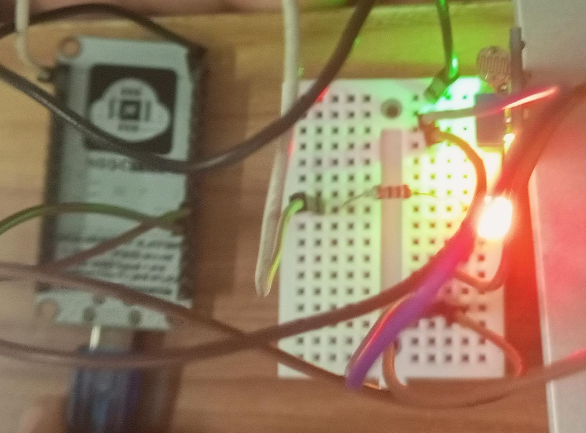

# Smart-Light-Control-using-KiwisIoT
# KiwisIoT Smart Light Control
# Description
An IoT-based project using NodeMCU ESP8266 and an LDR sensor to detect room brightness, automatically control an LED, and monitor LED status and light intensity through the KiwisIoT platform.
# Components Required
- NodeMCU ESP8266
- LDR Sensor
- LED
- Resistor
- Breadboard
- Connecting Wires
# Working
- LDR sensor detects the surrounding light intensity.
- When the room is dark, the LED turns ON.
- When the room is bright, the LED turns OFF.
- LED status, room brightness, and LDR value are sent to KiwisIoT.
# Project Images

![Output]
# Source Code
[View Source Code](light.ino)
# Technologies Used
- Arduino IDE
- NodeMCU ESP8266
- KiwisIoT
- Embedded C++
